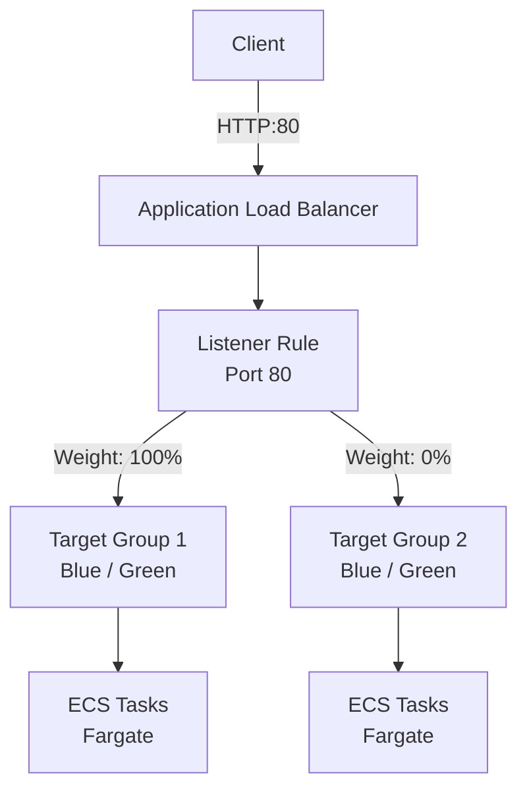

# aws-ecs-blue-green-deployment

AWS ECS のネイティブ Blue/Green デプロイメント機能（CodeDeploy を使用しない ECS 組み込みのデプロイ戦略）を検証するための Terraform 構成です。

Application Load Balancer（ALB）と Amazon ECS（Fargate）を連携させ、タスク定義更新時にトラフィックが Blue/Green 方式で自動的に切り替わる仕組みを構築します。

## アーキテクチャ概要



- **ALB リスナールール**: 重み付けフォワード（初期値 100:0）を設定。ECS サービスが自動で重みを切り替えるため、Terraform 側では `ignore_changes = [action]` を設定
- **ECS サービス**: デプロイ戦略に `BLUE_GREEN` を指定し、`advanced_configuration` で本番リスナールールおよび代替ターゲットグループを指定
- **Bake Time**: トラフィック切り替え後の待機時間（`bake_time_in_minutes = 1`）を経て、旧タスクが自動停止

## 使い方

### インフラの構築

Terraform を初期化し、リソースを作成します。

```sh
terraform init
terraform plan
terraform apply
```

適用完了後、出力された `elb_dns_name` を確認します。

```sh
curl "http://$(terraform output -raw elb_dns_name)"
```

デプロイ時のタイムスタンプ（`plantimestamp()` の値）が応答します。

### Blue/Green デプロイの検証

`terraform_data.main` リソースを置換（replace）して `terraform apply` を実行します。

```sh
terraform apply -replace=terraform_data.main
```

`terraform_data.main` のタイムスタンプが更新されることでタスク定義の新しいリビジョンが生成され、ECS サービスの Blue/Green デプロイが発動します。

#### デプロイ動作の流れ

1. Green 用の新しいタスクが起動
2. ターゲットグループのヘルスチェックを通過
3. ALB リスナールールのトラフィック重みが自動で切り替わり、アクセス先が新バージョンへ移行
4. 設定された Bake Time（1 分間）が経過
5. Blue 側の旧タスクが自動停止・削除

## 注意点・制約事項

### リスナールールにおけるターゲットグループの重複不可

ECS ネイティブ Blue/Green デプロイメントでは、同一のターゲットグループを複数のリスナールールで併用することはできません。

#### 発生するケースの例

例えば、パス `/private/*` に対して特定の送信元 IP のみアクセスを許可したい場合、ALB のリスナールールで以下のように優先度順に多段設定することが考えられます。

- 優先度高: 特定の IP かつ `/private/*` → ターゲットグループへフォワード
- 優先度中: `/private/*` → 404（または 403）固定レスポンス
- 優先度低（デフォルト）: `/` → ターゲットグループへフォワード

この場合、優先度高のルールと優先度低のルールの両方で同一のターゲットグループへフォワードすることになりますが、**ECS ネイティブ Blue/Green デプロイメントではこの構成は成立しません**。

#### 理由

- ECS サービスの `advanced_configuration` に指定可能な本番リスナールール（`production_listener_rule`）は 1 つのみ
- デプロイ時に ECS が Blue 側と Green 側のターゲットグループの重み（Weight）を自動で切り替えるのは、指定された単一のリスナールールのみ
- 別のリスナールールで同じターゲットグループを参照していると、デプロイ完了後もそのルールの重みは切り替わらず、旧バージョンへのトラフィック送信が残ったり、新旧バージョンが混在する不整合が発生

#### 代替案

特定のパスへの IP 制限や条件分岐を行いたい場合、以下の代替手段を検討してください。

- **AWS WAF によるアクセス制御（推奨）**: ALB の前段に AWS WAF（Web ACL）を関連付け、WAF ルールで特定 IP 以外のアクセスをブロック。ALB 側のリスナールールは単一ルールのみで済むため、ECS Blue/Green デプロイと完全に両立可能
- **コンテナ（アプリケーション）側でのアクセス制御**: ALB ではなく、コンテナ内の Web サーバー（nginx の `allow` / `deny` ディレクティブなど）やアプリケーション側で送信元 IP およびパスのアクセス制御を実施。ALB 側は単一のリスナールールを維持可能
- **ALB またはドメイン・ポートの分離**: 制限が必要な `/private/*` の機能を別ドメイン（例: `internal.example.com`）や別ポート、あるいはプライベートな内部 ALB（Internal ALB）としてエンドポイント自体を分離

### サービスディスカバリとの併用不可

ECS ネイティブ Blue/Green デプロイメントでは、Cloud Map によるサービスディスカバリ（`service_registries`）を併用できません。デプロイ戦略が `ROLLING` 以外のサービスにサービスディスカバリを設定しようとすると、次のエラーになります。

```
InvalidParameterException: Service Registries are only supported for ROLLING deployment strategy.
```

#### CodeDeploy による Blue/Green の場合

CodeDeploy による Blue/Green デプロイメント（デプロイコントローラーが `CODE_DEPLOY`）であれば、サービスディスカバリと併用できます。ただし、その場合でも Blue/Green になるのはロードバランサー経由の通信のみで、サービスディスカバリ経由の通信は Blue/Green になりません。

#### 代替案

サービス間の通信も Blue/Green にしたい場合は、サービスディスカバリの代わりに ECS Service Connect を使用します。

- ECS ネイティブ Blue/Green デプロイメントは Service Connect に対応しており、Service Connect 経由の通信もデプロイに合わせて Blue から Green へ切り替わる
- デプロイ中、Green 側は Cloud Map にテスト用のエンドポイントとして登録され、テストトラフィック用のヘッダ（デフォルトは `x-amzn-ecs-blue-green-test`）を付けたリクエストのみが Green 側へルーティングされる
- 本番トラフィックの切り替え時に、各クライアントの Service Connect プロキシのルーティングが自動で更新されるため、DNS レコードの更新などは不要
- Service Connect で接続するクライアント側のサービスも、同じ名前空間で Service Connect を有効にする必要がある
