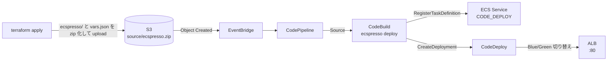

# aws-ecs-ecspresso-codedeploy

ECS を CodeDeploy で Blue/Green デプロイし、そのデプロイを CodePipeline → CodeBuild 上の [ecspresso](https://github.com/kayac/ecspresso) で実行する実験用の構成です。

## 構成



- インフラ（VPC、ALB、ECS クラスター・サービス、CodeDeploy、パイプライン）はすべて Terraform で作成
- ECS サービスは Terraform が初期タスク定義で作成し、`task_definition` と `load_balancer` は `ignore_changes`
- ecspresso はタスク定義の登録と CodeDeploy デプロイの作成のみを行う（`service_definition` は指定しない）
- ecspresso の設定に必要な ARN などは Terraform が `vars.json` として生成し、ecspresso の設定ファイルと一緒に zip に同梱（jsonnet から `import`）
- CodePipeline の S3 ソースは zip が前提のため、Terraform の `archive_file` で zip 化して S3 にアップロード

## ファイル

- `ecspresso/ecspresso.jsonnet` ecspresso の設定
- `ecspresso/ecs-task-def.jsonnet` タスク定義
- `ecspresso/vars.json` ローカルで `ecspresso render` などを試すためのサンプル（zip には Terraform が生成したものが入る）
- `buildspec.yml` CodeBuild のビルド定義（ecspresso をダウンロードして `ecspresso deploy` を実行）
- `pipeline.tf` S3、CodeBuild、CodePipeline、EventBridge のトリガー
- `codedeploy.tf` CodeDeploy のアプリケーションとデプロイグループ
- `ecs.tf` / `elb.tf` / `vpc.tf` ECS、ALB、VPC

## 使い方

```sh
terraform init
terraform apply
```

パイプラインは作成時に一度実行され、ecspresso によるデプロイが行われます。

```sh
curl "$(terraform output -raw app_url)"
```

`ecspresso/ecs-task-def.jsonnet` の `MESSAGE` 環境変数を書き換えて再度 `terraform apply` すると、zip が S3 にアップロードされてパイプラインが起動します。

```sh
terraform apply
```

新しいタスクが起動すると CodeDeploy がリスナーのターゲットグループを切り替え、新しい内容が返るようになります。

```sh
curl "$(terraform output -raw app_url)"
```

デプロイの状況は CodeBuild のログや CodeDeploy で確認できます。

```sh
aws codepipeline list-pipeline-executions --pipeline-name "$(terraform output -raw pipeline_name)" --max-items 3
aws deploy list-deployments --application-name ecspresso-codedeploy --deployment-group-name ecspresso-codedeploy
```

## 後片付け

```sh
terraform destroy
```

ecspresso が登録したタスク定義のリビジョンは Terraform の管理外なので残ります。
